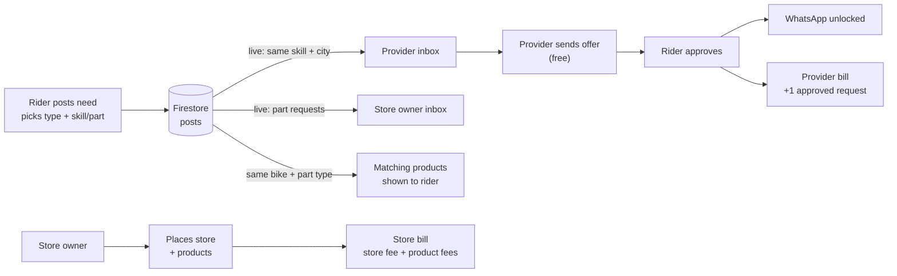

# PitStop — MVP Feature Document (1-Day Hackathon · Firebase Edition)
### Community Platform for Pakistani Heavy Bike Owners

---

## Problem Statement

Pakistani heavy bike owners have no trusted place to find skilled mechanics, buy genuine parts, or get real advice. Today they choose between overpriced shops and chaotic Facebook groups.

---

## The Core Idea

A rider posts a **need** and **picks what it is**: a service, a part, or a question.
PitStop sends it to **the right people only**.
Mechanics send offers, the rider **approves one**, and they connect on WhatsApp.

> You need detailing → only detailers in your city see it.
> You need a headlight → every store sees it, and matching products show up right away.
> You hear a weird engine noise → the community diagnoses it.

**Demo moment:** a rider posts on one laptop, and a detailer's inbox updates on a second laptop in under 2 seconds. The rider approves the detailer's offer, and the detailer's bill goes up by one approved request. The judges see the product and the business model working together.

---

## User Types

| Type | Who They Are | Pays? |
|---|---|---|
| **Rider** | Heavy bike owner | Free |
| **Service Provider** | Mechanic, detailer, tuner, modifier | Per request the rider approves |
| **Store Owner** | Parts shop or seller | For placing their store + each product |

> Each account has one role, picked at signup. This keeps the build simple.

---

## Feature 1 — Need Posting (the rider decides)

There is no AI classification. The rider chooses the type themselves:

1. **What do you need?** Three big buttons: **Service** · **Part** · **Question**
2. **Service:** pick a skill tag. **Part:** pick a part type. **Question:** nothing extra.
3. Pick a bike from the dropdown and a city, write a description, and add photos if you want.

**Who sees it:**

| Rider picks | Who sees it |
|---|---|
| Service + skill | Providers with that skill **in the same city** |
| Part + part type | **All store owners**. The rider also sees matching products right away |
| Question | Public community feed |

Routing is plain Firestore queries. There is no AI and no server code in this path.

**Not sure what you need?** An "Ask the AI Assistant" link opens Feature 6, which suggests the mechanic type and pre-fills this form. The rider still confirms.

**Skill tags (8):** General · Engine · Electrical · Tuning · Detailing · Tyres · Modification · Bodywork & Paint

**Part types (~12):** Headlight · Tail light · Indicators · Brake pads · Chain & sprocket kit · Tyre · Battery · Air filter · Oil filter · Mirrors · Body panels · Exhaust · Other

**Bike dropdown:** about 20 popular models (Honda CBR150R / CBR250RR, Yamaha R15 / R3, Suzuki GSX-R150, Kawasaki Ninja 250 / 400 / 650, KTM Duke 390, Benelli TNT / TRK, and others) plus "Other". Each one maps to a `bikeKey` such as `honda-cbr150r`.

---

## Feature 2 — Offers & Approval (where the money comes from)

1. A matching provider sees the request in their **live inbox**.
2. The provider sends an **offer**: a short message, a price estimate in Rs., and when they can do it. **Sending an offer is free.**
3. The rider sees the offers, sorted by provider rating.
4. The rider taps **Approve** on one offer. The offer update and the post update go in **one `writeBatch`**, so they always land together. Then:
   - the request is marked **Assigned**, and the Approve button on every other offer is disabled
   - a **WhatsApp button** with a pre-filled message appears for the rider and the approved provider, **on the request page only**
   - the provider is **charged one approved-request fee**

> Providers pay only for jobs a rider actually chose them for. They never pay for leads that go nowhere.
> Pitch line: **"Riders connect only after approving, and that's when providers pay."**

---

## Feature 3 — Service Provider Profiles

- Name, city, skill tags, bike brands they work on
- Portfolio photos (up to 4)
- Star rating and reviews, **read-only** (both come from the seed data; there is no "write a review" in the MVP)
- **Approved jobs** count, which builds trust
- **No WhatsApp button on the public profile.** Contact opens only after the rider approves an offer.

---

## Feature 4 — Stores & Products

**Store owner flow:**
1. **Create a store:** name, city, area, logo, and WhatsApp number. *Charged a store placement fee.*
2. **Add products:** name, part type, compatible bikes (multi-select), price in Rs., and photos (at least 1). *Charged a fee for each product.*
3. **Condition:** `New – Genuine` · `New – Copy` · `Used – Genuine`. We say "copy" plainly because that is what buyers ask about first.
4. To take a product down, mark it **Sold**. Products are never deleted, so the product count used for billing stays accurate.

**Rider side:**
- Browse products by **bike + part type**
- When a rider posts a part request, matching products appear on the request page right away (same bike and same part type)
- Store owners see part requests in their inbox and can **suggest a product** from their store, for free
- Each store page has a trust badge and a WhatsApp button

---

## Feature 5 — Community Feed

- Anyone signed in can post questions and reply
- Providers' replies show a **"Mechanic"** badge
- Upvotes on replies, with the best answer on top
- Filter the feed by bike model

**AI Layer: duplicate check.** Before a question is posted, we send it and the 30 most recent questions about the same bike to Claude. Claude returns up to 3 similar threads, and we show: *"Someone already asked this — here's what riders said."*

---

## Feature 6 — AI Bike Assistant (The Differentiator)

A chat page where the rider describes a problem. Replies stream in as they are written. The assistant is **English only**.

The assistant always gives:
- 2–3 likely causes
- **DIY or pro?**
- Which mechanic to book (one of the 8 skill tags)
- A rough time and a cost range in Rs., clearly labelled as an estimate
- **A safety rule:** for brakes, steering, or a fuel leak, it tells the rider to stop riding and see a pro

**"Post this as a need"** pre-fills Feature 1 with type = Service, the suggested skill tag, and the rider's problem. The rider checks it and posts. The AI suggests, and the rider decides.

**Example:**
> "My CBR 150 is vibrating at high speed"
> AI: "Likely a wheel balancing issue or a loose front axle nut. This is a 30-minute job. Book a **General** mechanic; it should cost about Rs. 500–800 (rough estimate)."
> **[ Post this as a need ]**

To pre-fill the skill reliably, the system prompt tells the assistant to end with a line like `Mechanic: General`. The client matches that line against the 8 tags.

---

## Revenue Model

Riders use PitStop free. **Service providers** and **store owners** pay.

| Who pays | For what | Example price* | When it's counted |
|---|---|---|---|
| Service provider | Each request a rider **approves** | Rs. 150 per approved request | When the rider taps Approve |
| Store owner | **Placing their store** on PitStop | Rs. 2,000 / month | Every month the store is active |
| Store owner | **Each product placed** | Rs. 50 per product | When the product is listed |

\*These are example prices. They live in one Firestore document (`config/pricing`), so you can change them in the Firebase console without redeploying.

**Billing page (in the MVP):** each provider or store owner sees what they owe this month.
- **Provider:** `approved requests this month × approvedRequestFee`
- **Store owner:** `storeMonthlyFee + products listed this month × productFee`

Both are worked out from data that already exists, using Firestore `count()` queries. There is no separate billing ledger to keep in sync.

**Collecting payment:** there are no in-app payments in the MVP. Bills are settled outside the app (JazzCash, Easypaisa, or bank transfer), and in-app payments come after the hackathon. The MVP only tracks what is owed; it doesn't block anyone who hasn't paid.

---

## Tech Stack (Firebase, 1-Day Ready)

| Layer | Choice | Why |
|---|---|---|
| Frontend + API | **Next.js (App Router)** | One codebase. API routes keep the Claude key on the server |
| Auth | **Firebase Auth — Google sign-in** | Takes about 5 minutes to set up |
| Database | **Cloud Firestore** | Live inboxes. Security rules protect approvals and billing data |
| File uploads | **Firebase Storage** | Needs the Blaze plan (see Gotchas). Fallback: Cloudinary unsigned upload |
| Server | **Firebase Admin SDK** in 2 API routes + the seed script | Checks sign-in tokens before calling Claude |
| AI | **Claude API — `claude-opus-5-5`** | Bike Assistant and duplicate check only |
| Hosting | **Vercel** | Deploys on every push |

**Most of the app needs no server code.** Posts, offers, approvals, stores, and products are written straight to Firestore, and the security rules guard them. Only the two AI features run through API routes.

**Removed from the original stack:** Express, MongoDB, Clerk/NextAuth, and Railway.

### Architecture



---

## Firestore Data Model

```ts
// users/{uid}
{
  name, photoURL, city, whatsapp: "923001234567",
  role: "rider" | "provider" | "store_owner",
  // providers only
  skills: ["detailing", "tuning"], brands: ["Honda", "Kawasaki"],
  portfolio: [url], rating: 4.6, ratingCount: 12
}
// users/{uid}/reviews/{id}  → { riderId, riderName, rating: 1-5, text, createdAt }

// posts/{postId}
{
  authorId, authorName, city,
  bikeKey: "honda-cbr150r", bikeLabel: "Honda CBR150R 2019",
  type: "service" | "part" | "question",     // picked by the rider
  skill: "detailing" | null,                 // service only
  partType: "headlight" | null,              // part only
  text, photos: [url],
  status: "open" | "assigned" | "closed",
  approvedOfferId: null,
  upvotes: 0, replyCount: 0, createdAt
}
// posts/{postId}/replies/{id}  → { authorId, authorName, role, text, upvotes, productId?, createdAt }

// offers/{offerId}
{
  postId, postAuthorId,
  providerId, providerName, providerRating,
  message, priceEstimate, when,
  status: "pending" | "approved" | "declined",
  createdAt, approvedAt                      // approvedAt drives billing
}

// stores/{ownerUid}       — one store per owner
{ ownerId, name, city, area, logoURL, whatsapp, verified, createdAt }

// products/{productId}
{
  storeId, storeName, city, whatsapp,
  name, partType: "headlight", bikeKeys: ["kawasaki-ninja400"],
  condition: "new_genuine" | "new_copy" | "used_genuine",
  price, photos: [url],
  status: "active" | "sold",
  createdAt                                  // drives billing
}

// config/pricing          — edit in the console
{ approvedRequestFee: 150, storeMonthlyFee: 2000, productFee: 50 }
```

**Key queries:**
| Screen | Query |
|---|---|
| Provider inbox | `posts` where `type == "service"`, `skill in mySkills`, `city == myCity`, `status == "open"`, order by `createdAt desc` |
| Store owner inbox | `posts` where `type == "part"`, `status == "open"`, order by `createdAt desc` |
| Offers on my post | `offers` where `postId == X`, order by `providerRating desc` |
| Matching products | `products` where `bikeKeys array-contains bikeKey`, `partType == X`, `status == "active"` |
| Community feed | `posts` where `type == "question"` (+ `bikeKey ==`), order by `createdAt desc` |
| Provider bill | `count()` of `offers` where `providerId == me`, `status == "approved"`, `approvedAt >= monthStart` |
| Store bill | `count()` of `products` where `storeId == me`, `createdAt >= monthStart` |

---

## AI Integration (2 API routes)

| Route | When | What Claude does |
|---|---|---|
| `POST /api/assistant` | Chat message | Diagnoses the problem, streams the reply, ends with `Mechanic: <tag>` |
| `POST /api/similar` | Before a question is posted | Compares it with the 30 latest questions for that bike and returns up to 3 similar post IDs |

**Rules for both routes:**
- `ANTHROPIC_API_KEY` stays on the server. Never give it a `NEXT_PUBLIC_` prefix.
- Each route checks the caller's Firebase ID token (`adminAuth.verifyIdToken`) so strangers can't spend your Claude credits.
- Use structured outputs (a JSON schema) for `/api/similar` at low effort. Stream the Assistant's replies.
- The system prompt says: **English only**, Pakistani heavy-bike context, costs in Rs. labelled as estimates, and the safety rule.

---

## Firestore Security Rules (simple, demo-safe)

```js
rules_version = '2';
service cloud.firestore {
  match /databases/{db}/documents {
    function signedIn() { return request.auth != null; }
    function onlyChanged(keys) {
      return request.resource.data.diff(resource.data).affectedKeys().hasOnly(keys);
    }

    match /users/{uid} {
      allow read: if true;
      allow write: if signedIn() && request.auth.uid == uid;
      match /reviews/{id} {
        allow read: if true;
        allow create: if signedIn() && request.resource.data.riderId == request.auth.uid;
      }
    }

    match /posts/{postId} {
      allow read: if true;
      allow create: if signedIn()
        && request.resource.data.authorId == request.auth.uid
        && request.resource.data.status == 'open';
      allow update: if signedIn() && (
        (resource.data.authorId == request.auth.uid && onlyChanged(['status', 'approvedOfferId']))
        || onlyChanged(['upvotes', 'replyCount'])
      );
      match /replies/{id} {
        allow read: if true;
        allow create: if signedIn() && request.resource.data.authorId == request.auth.uid;
        allow update: if signedIn() && onlyChanged(['upvotes']);
      }
    }

    match /offers/{offerId} {
      allow read: if signedIn();
      // a provider makes an offer on a real post
      allow create: if signedIn()
        && request.resource.data.providerId == request.auth.uid
        && request.resource.data.status == 'pending'
        && get(/databases/$(db)/documents/posts/$(request.resource.data.postId)).data.authorId
           == request.resource.data.postAuthorId;
      // only the rider who posted can approve or decline; the server sets the time
      allow update: if signedIn()
        && resource.data.postAuthorId == request.auth.uid
        && onlyChanged(['status', 'approvedAt'])
        && request.resource.data.status in ['approved', 'declined']
        && (request.resource.data.status != 'approved' || request.resource.data.approvedAt == request.time);
    }

    match /stores/{ownerId} {
      allow read: if true;
      allow create, update: if signedIn() && request.auth.uid == ownerId;
    }

    match /products/{id} {
      allow read: if true;
      allow create: if signedIn()
        && request.resource.data.storeId == request.auth.uid
        && exists(/databases/$(db)/documents/stores/$(request.auth.uid));
      allow update: if signedIn() && resource.data.storeId == request.auth.uid;
      allow delete: if false;   // mark as "sold" instead, so billing counts stay honest
    }

    match /config/{doc} {
      allow read: if true;
      allow write: if false;    // change prices in the Firebase console
    }
  }
}
```

> **Keep these rules as written.** They already block the important things: providers can't approve their own offers, products can't be deleted, and approval uses server time. That's enough for a demo.
>
> **Skipped for now:** locking ratings, blocking backdated products, the verified badge, and stopping fake upvotes. If a judge asks: *"Billing fields get locked down in the security rules after the hackathon. For the MVP, we track what's owed."*

---

## Project Structure

```
app/
  page.tsx                  # community feed
  onboarding/page.tsx       # pick role, city, skills/brands, WhatsApp
  post/new/page.tsx         # post a need (type → skill / part type)
  posts/[id]/page.tsx       # request detail: offers + Approve, matching products
  inbox/page.tsx            # provider / store owner live inbox
  providers/[id]/page.tsx   # provider profile + seeded reviews (read-only)
  stores/new/page.tsx       # create store
  stores/[id]/page.tsx      # store page + products
  products/new/page.tsx     # add product
  parts/page.tsx            # browse products by bike + part type
  billing/page.tsx          # what I owe this month
  assistant/page.tsx        # AI Bike Assistant
  api/assistant/route.ts    # streaming chatbot
  api/similar/route.ts      # duplicate-thread check
lib/
  firebase.ts               # client SDK (Auth, Firestore, Storage)
  firebase-admin.ts         # Admin SDK (server only)
  claude.ts                 # Anthropic client + prompts
  bikes.ts · skills.ts · partTypes.ts
  billing.ts                # count() queries + pricing
scripts/seed.ts             # demo data + config/pricing
firestore.rules
.env.local                  # NEXT_PUBLIC_FIREBASE_*, FIREBASE_SERVICE_ACCOUNT, ANTHROPIC_API_KEY
```

---

## MVP Scope (1-Day Build)

**Build only this.**

| Feature | In MVP? |
|---|---|
| Need posting (rider picks type + skill / part type) | ✅ |
| Live inbox for providers and store owners | ✅ |
| Offers + rider approval (one batched write) + WhatsApp unlock | ✅ |
| Provider profiles + seeded reviews (read-only) | ✅ |
| Writing reviews | ❌ (ratings and reviews come from the seed) |
| Stores + products, browse by bike and part type | ✅ |
| Billing page (approved requests, store and product fees) | ✅ |
| Community feed + replies + upvotes | ✅ |
| Duplicate-thread suggestion (AI) | ✅ (cut first if behind) |
| AI Bike Assistant + "Post this as a need" | ✅ |
| Google sign-in | ✅ |
| AI auto-sorting of posts | ❌ (the rider decides) |
| Urdu / Roman Urdu | ❌ (English only) |
| In-app payments | ❌ (bills settled offline) |
| Admin revenue dashboard | ❌ (stretch goal) |
| Phone OTP login | ❌ |
| Real-time chat | ❌ (WhatsApp instead) |
| Map view | ❌ |
| Push notifications | ❌ (the live inbox covers this) |

---

## 1-Day Build Plan (~10 hours)

| Time | Build | Done when |
|---|---|---|
| 0:00–1:00 | Next.js app, Firebase project (Auth, Firestore, Storage), Vercel deploy, env vars | A blank app is live on Vercel with Google sign-in |
| 1:00–2:00 | Onboarding + **seed script** (users with ratings and reviews, stores, products, `config/pricing`) | 6 providers with reviews, 3 stores, 20 products, 10 threads in Firestore |
| 2:00–3:30 | Post a Need + live inboxes | Post on laptop A → inbox updates on laptop B |
| 3:30–5:00 | Offers + Approve (one `writeBatch`) + WhatsApp unlock + provider profile | Approve → Assigned, the other offers are disabled, WhatsApp opens |
| 5:00–6:30 | Create store, add product, browse, matching products on part requests | A part request shows matching products |
| 6:30–7:15 | Billing page | The provider and store owner see correct amounts |
| 7:15–8:30 | Assistant (streaming) + "Post this as a need" | The CBR 150 vibration demo works end to end |
| 8:30–9:15 | Feed, replies, upvotes, `/api/similar` | "Someone already asked this" appears |
| 9:15–10:00 | Polish, deploy rules, **rehearse the demo twice** | 3-minute demo runs without errors |

**If you fall behind, cut in this order:** duplicate check → photo upload (use seeded photos) → upvotes.

**Seed data matters:** spread providers across Lahore, Karachi, and Islamabad with different skills, so the routing visibly changes by city.

---

## 3-Minute Demo Script

Use two browser windows: **Rider** (left) and **Detailer, Lahore** (right). Keep a tab with a tuner's inbox to show that it stays empty.

1. **Post & route (40s).** The rider picks **Service → Detailing**, Honda CBR250RR, Lahore: *"Full detailing before a weekend ride."* The detailer's inbox updates live, and the tuner's doesn't.
2. **Offer & approve (40s).** The detailer sends an offer with a price and a time. The rider taps **Approve**: the request shows Assigned, the other offers can't be approved, and WhatsApp appears for the first time. Say: *"Riders connect only after approving, and that's when providers pay."* On the detailer's **Billing** page: *1 approved request · Rs. 150 due.*
3. **Parts (40s).** The rider picks **Part → Headlight**, Kawasaki Ninja 400. Matching products from 2 stores appear at once, one labelled `New – Copy`. Switch to a store owner's **Billing** page: store fee plus fees for their products.
4. **Assistant (45s).** *"My CBR 150 is vibrating at high speed"* → causes, DIY or pro, Rs. 500–800 → **Post this as a need** → the form is pre-filled with **General**, and the rider confirms.
5. **Close (15s).** Show the revenue table: riders free, providers pay per approved job, stores pay for placement.

---

## Firebase Gotchas (read before you start)

**These three break the demo if you skip them:**
1. **Create the Firestore indexes in advance.** Open every screen once on the deployed site before the pitch, and click each "index required" link.
2. **Use `serverTimestamp()` for `approvedAt`**, or the approve step fails the security rules.
3. **Add your Vercel domain to Firebase Auth's authorized domains**, or Google sign-in fails on stage.

More details:

- **Storage needs the Blaze plan** on new projects. Add a card and set a budget alert of about $5; hackathon usage stays inside the free quota. If you can't add a card, use Cloudinary for images.
- **Firestore location can't be changed later.** Pick the region closest to Pakistan (e.g. `asia-south1`, Mumbai).
- **"Index required" errors:** the console error includes a link. Click it, wait about a minute, and the query works. The inbox, offers, and billing queries all need one.
- **Use `serverTimestamp()` for `approvedAt`.** The rule checks it against `request.time`, so a value set by the client's clock is rejected.
- **Add your Vercel domain** in Auth → Settings → Authorized domains, or Google sign-in fails on the deployed site.
- **Service account in Vercel:** store the JSON as one env var. Watch the `\n` in `private_key`; replace `\\n` with `\n` when you load it.
- **Publish `firestore.rules`.** Test mode leaves the database wide open and expires after 30 days.

---

## Hackathon Pitch (One Line)

> *"I built PitStop — a platform where Pakistani heavy bike owners find the right mechanic, genuine parts, and real advice. Riders use it free, mechanics pay only for jobs riders approve, and parts stores pay to be on the shelf."*

---

## Why This Wins

- **Real problem.** Every heavy bike owner in Pakistan has lived this pain.
- **Business model from day one.** Revenue is visible in the demo: approved jobs and store placements turn into bills.
- **Riders stay in control.** They choose what they need and which mechanic gets the job. AI helps only when they are unsure.
- **Fair to providers.** Offers are free; providers pay only when a rider picks them.
- **Pakistan-first.** WhatsApp contact, Rs. pricing, honest "copy vs genuine" labels, and payments through JazzCash, Easypaisa, or bank transfer.
- **Shippable in a day.** One Next.js app, one Firebase project, two AI routes.

---

*Built for Pakistani riders. By someone who gets it.*
